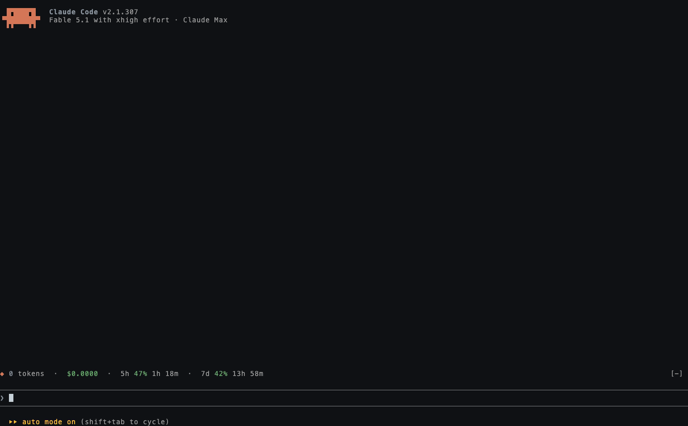

# Claude Code plugins

Two mods for the Claude Code terminal.

- **usage-meter**: a token and cost line above the prompt, plus a popup with this session's usage and your last 24 hours to 90 days of Claude Code and Codex use.
- **paste-viewer**: hover previews for images you paste, and a popup that shows long pasted prompts in full.



## Install

At the prompt of a Claude Code terminal session:

```
/plugin install usage-meter --marketplace anthonyamaro15/claude-code-plugins
/plugin install paste-viewer --marketplace anthonyamaro15/claude-code-plugins
```

Answer `y` to add the marketplace, then pick a scope (user scope loads the mod in every session). The mod starts working right away.

From a shell:

```
claude plugin install usage-meter --marketplace anthonyamaro15/claude-code-plugins
claude plugin install paste-viewer --marketplace anthonyamaro15/claude-code-plugins
```

To update later: `claude plugin update usage-meter` (or `paste-viewer`), then `/reload-plugins`.

## Requirements

- A recent Claude Code version that supports mods. These were built and tested on 2.1.304 and 2.1.305.
- The fullscreen terminal UI (`tui: fullscreen`) is recommended. It docks the usage popup on the right and turns on the hover previews.
- `python3` on your `PATH`, for usage-meter's 24h to 90d history only. The meter line and the Session view work without it.

## usage-meter

A line above the prompt shows this session's tokens and cost. `/usage-meter` opens the popup:

- **Session**: cost, tokens, a per-turn chart and cost by type (input, output, cache reads, cache writes).
- **24h, 7d, 30d, 90d**: history from the session logs on this computer, broken down by model or by day, split between Claude Code and Codex. 90d adds a daily activity calendar.
- **Limits**: your 5-hour and weekly rate-limit use, with the pace you're on.

Commands:

| Command | What it does |
| --- | --- |
| `/usage-meter` | Open or close the popup |
| `/usage-meter cost 30d` | Open on a view: `cost`, `tokens` or `limits`, and `session`, `24h`, `7d`, `30d` or `90d` |
| `/usage-meter font blocky` | Headline font: `smooth`, `rounded`, `bold` or `blocky` |
| `/usage-meter bg #0d1117` | Popup background: a hex color, `none`, or `default` |

Font and background choices are saved across sessions.

**Privacy**: history is read only from local files: `~/.claude/projects` (or `$CLAUDE_CONFIG_DIR/projects`) and, if Codex is installed, `~/.codex/sessions` (or `$CODEX_HOME/sessions`). Nothing is sent anywhere. Sums are cached in `~/.cache/usage-meter/`.

**Pricing**: costs use the API list prices built into `usage-meter/scripts/scan.py`, so they show what the same use would cost on the API, not what a subscription charges. Models without a known price are counted as tokens and noted as unpriced.

## paste-viewer

- Pasted images show as a dim "1 image · hover to preview" line under your message. Hover it to see the image.
- A long pasted prompt (more than 12 lines or 1,200 characters) gets a "View N lines" link under it that opens a popup with the full text. `/pastes` opens the latest one, and the popup steps through every long prompt pasted this session.

## Development

Each mod is a folder with `.claude-plugin/plugin.json` and a hooks module in `hooks/register.tsx`. To run one from a local copy:

```
claude --plugin-dir ./usage-meter
```

Checks:

```
claude plugin validate ./usage-meter
claude plugin test ./usage-meter
python3 -I usage-meter/scripts/scan_check.py
```

## License

MIT
